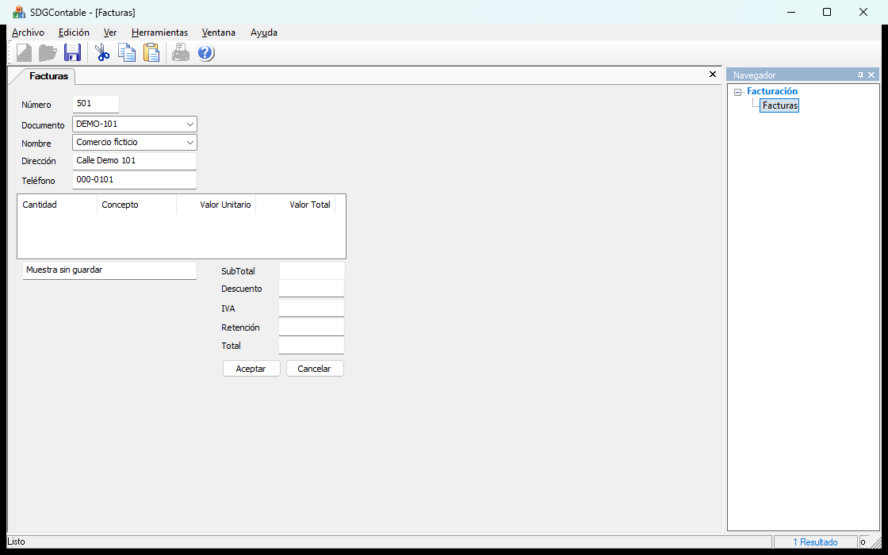
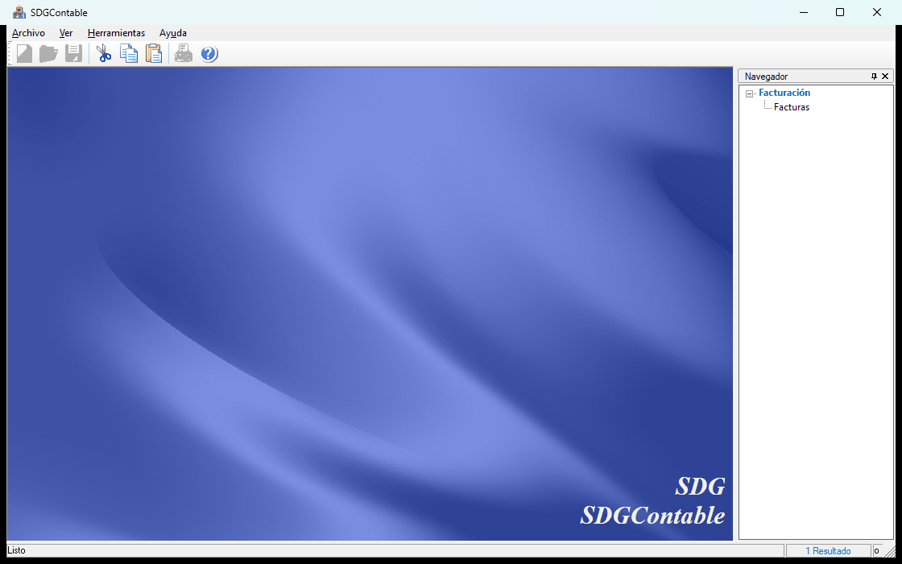

# SDGContable
[English](#english) · [Español](#español)

## English

Legacy Windows back office for customer and supplier records, users and access groups

> [!WARNING]
> **Status: Legacy.** Use the local test setup to explore the recovered Windows program.


### Overview

SDGContable keeps records a small office needs to identify the people and organizations it works with. It also groups software users by the actions they can take. The recovered application provides the Windows shell and administration screens.

### Features

- Open the archived invoice form in **Facturación → Facturas**. It shows customer fields, item columns and tax and total boxes.
- In the registered administration module, update **Clientes** and **Proveedores**.
- Add or edit **Usuarios**, assign them to **Grupos** and set group access in the permissions list.
- Keep auxiliary lookups under **Misceláneos**.

### Requirements

The official archived MySQL 5.0.16 Windows ZIP supplies COPYING and EXCEPTIONS-CLIENT in vendor/mysql-sdk.

Use the x86 .NET Framework 4 C# compiler to build the separate application-module probe.

The exact archived third-party files are included. Their notices and hashes are in THIRD-PARTY-NOTICES.md.

- Visual Studio Community 2026 with MSVC v145, MFC, and Windows SDK 10.0.26100.0. Verified with Visual Studio 18.11.4 and MSBuild 18.11.1.51303. Use the Win32 target.
- The recovered `libreria1` sources replace the original Windows library build. Its archived `Aldia()` method is absent in source. `Template/MainFrm.cpp` records the installation folder with the available `CMyRegKey` API to preserve the archived DLL behavior.
- `vendor/mysql-sdk/` holds the archived x86 MySQL 5.0.16 headers, libmysql.lib, libmysql.dll and original terms.

### Getting started

From Developer PowerShell for Visual Studio, run the commands below from the repository root. The build uses the dependencies included in the checkout. MSBuild builds `SDGContable.exe` and its modules. The compatible startup in `Template/MainFrm.cpp` restores the installation-path update of the archived Componentes DLL, whose matching method is absent from the recovered shared sources.

```powershell
$sdk = (Resolve-Path ./vendor/mysql-sdk).Path
msbuild SDGContable.sln /t:Build /nologo /m:3 /nr:false /p:Configuration=Release /p:Platform=Win32 /p:PreferredToolArchitecture=x64 "/p:MySqlSdkDir=$sdk"
```

Default Release Win32 build settings leave product activation disabled. The original serial and trial checks at startup and on the timer are guarded by `ENABLE_LICENSE_CHECK` in `Template.cpp` and `MainFrm.cpp`. The database login supplies user identity and group permissions.

### Usage

Use PowerShell 7 and Docker Compose in a Windows test profile. The commands below start a local-only MySQL 5.7.44 instance with the fictional rows, then open the application with a temporary profile built from the exact compiled module checksums. Sign in as `consulta_demo` using the generated demo password in `$env:MYSQL_PASSWORD`. In the navigator, open **Facturación → Facturas** and enter example number 501 and name `Comercio ficticio`. The archived form can be filled, and the verification closes it without saving a transaction. Close the application before the cleanup commands. The optional **Administrador** menu uses the separately registered administration module. Its DLL builds with the solution and requires its own installation registration.

```powershell
Copy-Item -LiteralPath (Join-Path $sdk "libmysql.dll") -Destination .\bin\Release
$env:MYSQL_ROOT_PASSWORD = [guid]::NewGuid().ToString('N')
$env:MYSQL_PASSWORD = [guid]::NewGuid().ToString('N')
docker compose -f .\demo\compose.yaml up -d --wait
docker compose -f .\demo\compose.yaml cp .\demo\preparar-cuenta.sh mysql:/tmp/preparar-cuenta.sh
docker compose -f .\demo\compose.yaml exec -T mysql sh /tmp/preparar-cuenta.sh
.\demo\ProbarEscritorio.ps1 -Port 33067
docker compose -f .\demo\compose.yaml down --volumes
Remove-Item Env:MYSQL_ROOT_PASSWORD, Env:MYSQL_PASSWORD -ErrorAction SilentlyContinue
```

### Project structure

- `Template/Template.cpp` starts the Windows application.
- `Administrador/Administrador.cpp` starts the administration extension DLL.
- `appt/appt.cpp` provides the identity and image resources the application loads.
- `vendor/include/` contains the four shared-library projects used by `SDGContable.sln`. `vendor/src/` contains their implementations and `vendor/mysql-sdk/` holds the SDK.
- `compat/tmschema.h` maps the legacy theme include to the Windows SDK.
- `demo/compose.yaml` starts the disposable database. `demo/catalogos.sql` supplies fictional records and `demo/ProbarEscritorio.ps1` opens the test app.
- `docs/media/` contains the invoice form image and recording of the fictional desktop test.

### Support

This archived release has no active support. For reproduction, report the commit, toolset, and first error in the build output.

### Contributing

Use fictional records for reports and screenshots. Keep the historical snapshots and third-party notices when investigating compatibility.

### History

The archived desktop executable records January 20, 2009 as its link date. The 2026 commits document reconstruction and verification.

| Revision | Change |
| --- | --- |
| Jan 2009 source family, restored 17 Nov 2026 | Record management screens and their supporting Windows modules. |
| 17 Nov 2026 | Explain the origin of the sources and the limits of the build. |
| 18 Nov 2026 | Add the screenshot and animation of the fictional invoice trial recorded on November 19, 2026. |

### Archive evidence

The stored executables report linker dates on 19 and 20 January 2009. Debug checksums match most application files and the four recovered libraries. The available `MainFrm.cpp` differs from the copy used for the old binary. The source commit uses the archived executable link timestamp, January 20, 2009 at 00:24:06 UTC, as its Git author date. That timestamp does not establish the exact edit date. Git records the reconstruction in 2026 as the committer date.

### Verification

The Release Win32 command above compiled in the November 22–23, 2026 tests and in the November 24 repetition from separate Git exports. It produced SDGContable.exe and its six modules. The unmodified executable signed in, read user and permissions from disposable MySQL 5.7.44 at 127.0.0.1, opened Facturas, entered example 501, and closed without saving a transaction. An isolated diagnostic copy redirected two add-in lookups to a temporary user profile. Its original menu opened Usuarios, Clientes, Proveedores, Grupos and Misceláneos. The tested Release binary still needs a machine-level add-in registration to open those views. That installation workflow requires a separate Windows environment.

The 32-bit DLL check found eight exports and a 524 × 295 bitmap. The catalog check separately loaded six sample records and checked the additional legacy login and schedule tables. Run the following commands from the root of the build, after closing the desktop demo and shutting down its test database.

Tools used — Windows 11 Pro 26300, MSBuild 18.11.1.51303, MSVC toolset 14.51.36231 (cl.exe 19.51.36263) (v145), Windows SDK 10.0.26100.0, Microsoft Visual C# Compiler 14.8.10001.0, PowerShell 7.6.9, Docker Engine 29.9.2, Docker Compose 5.6.1, MySQL SDK 5.0.16 x86, MySQL 5.7.44.

```powershell
& "$env:WINDIR\Microsoft.NET\Framework\v4.0.30319\csc.exe" /nologo /platform:x86 /out:bin\Release\ProbarModulo.exe "$PWD\demo\ProbarModulo.cs"
& .\bin\Release\ProbarModulo.exe "$PWD\bin\Release\appt.dll"
.\demo\ProbarCatalogos.ps1
```

### Screenshots

The still image and animation show the separate invoice form trial recorded on November 19, 2026. The November 22 and 24 verifications repeated the invoice workflow with separate fictional fixtures.

The image shows the fictional invoice displayed in the Release Win32 desktop trial.





### License

See the [MIT license](LICENSE) for original contributions.

---

## Español

Aplicación legada para Windows con fichas de clientes y proveedores, usuarios y permisos por grupo

> [!WARNING]
> **Estado: Legado.** Usa el entorno local de prueba para explorar el programa recuperado de Windows.


### Descripción general

SDGContable reúne los datos que una oficina usa para identificar a las personas y organizaciones con las que trabaja. También agrupa a los usuarios según las acciones que pueden realizar. La aplicación recuperada incluye la interfaz de Windows y las pantallas de administración.

### Funciones

- Abre el formulario de factura archivado en **Facturación → Facturas**. Muestra campos del cliente, columnas de artículos y casillas de impuestos y totales.
- En el módulo de administración registrado, actualiza **Clientes** y **Proveedores**.
- Crea o edita **Usuarios**, asígnalos a **Grupos** y define el acceso en la lista de permisos.
- Conserva catálogos auxiliares en **Misceláneos**.

### Requisitos

El ZIP oficial archivado de MySQL 5.0.16 para Windows aporta COPYING y EXCEPTIONS-CLIENT en vendor/mysql-sdk.

Usa el compilador de C# de .NET Framework 4 para x86 para compilar la prueba separada del módulo.

Se incluyen las dependencias exactas del respaldo. Sus avisos y hashes figuran en THIRD-PARTY-NOTICES.md.

- Visual Studio Community 2026 con MSVC v145, MFC y Windows SDK 10.0.26100.0. Probado con Visual Studio 18.11.4 y MSBuild 18.11.1.51303. Selecciona Win32.
- Los fuentes recuperados de `libreria1` sustituyen la compilación original de la biblioteca de ventanas. Su método archivado `Aldia()` falta en los fuentes. `Template/MainFrm.cpp` registra la carpeta de instalación con la API disponible de `CMyRegKey` para conservar el comportamiento de la DLL archivada.
- `vendor/mysql-sdk/` contiene las cabeceras MySQL 5.0.16 x86, libmysql.lib, libmysql.dll y las condiciones originales.

### Cómo empezar

Desde Developer PowerShell para Visual Studio, ejecuta estos comandos en la raíz del repositorio. La compilación usa las dependencias incluidas en esta copia. MSBuild compila `SDGContable.exe` y sus módulos. El inicio compatible de `Template/MainFrm.cpp` recupera la actualización de la ruta de instalación de la DLL Componentes archivada. Su método falta en los fuentes compartidos que se conservaron.

```powershell
$sdk = (Resolve-Path ./vendor/mysql-sdk).Path
msbuild SDGContable.sln /t:Build /nologo /m:3 /nr:false /p:Configuration=Release /p:Platform=Win32 /p:PreferredToolArchitecture=x64 "/p:MySqlSdkDir=$sdk"
```

La configuración Release Win32 predeterminada tiene desactivada la activación del producto. Los chequeos originales de serial y periodo de prueba al iniciar y en el temporizador están bajo `ENABLE_LICENSE_CHECK` en `Template.cpp` y `MainFrm.cpp`. El inicio de sesión de la base de datos determina la identidad y los permisos por grupo.

### Uso

Usa PowerShell 7 y Docker Compose en un perfil de prueba de Windows. Los comandos siguientes inician MySQL 5.7.44 en localhost con registros ficticios y abren la aplicación con un perfil temporal preparado con las huellas de los módulos compilados. Ingresa como `consulta_demo` con la contraseña de prueba generada en `$env:MYSQL_PASSWORD`. En el navegador, abre **Facturación → Facturas** y escribe el número de ejemplo 501 y el nombre `Comercio ficticio`. Se puede llenar el formulario archivado. La verificación lo cierra sin guardar una transacción. Cierra el programa antes de los comandos de limpieza. El menú opcional **Administrador** usa un módulo que se registra por separado. Su DLL se compila con la solución y requiere dicho registro de instalación.

```powershell
Copy-Item -LiteralPath (Join-Path $sdk "libmysql.dll") -Destination .\bin\Release
$env:MYSQL_ROOT_PASSWORD = [guid]::NewGuid().ToString('N')
$env:MYSQL_PASSWORD = [guid]::NewGuid().ToString('N')
docker compose -f .\demo\compose.yaml up -d --wait
docker compose -f .\demo\compose.yaml cp .\demo\preparar-cuenta.sh mysql:/tmp/preparar-cuenta.sh
docker compose -f .\demo\compose.yaml exec -T mysql sh /tmp/preparar-cuenta.sh
.\demo\ProbarEscritorio.ps1 -Port 33067
docker compose -f .\demo\compose.yaml down --volumes
Remove-Item Env:MYSQL_ROOT_PASSWORD, Env:MYSQL_PASSWORD -ErrorAction SilentlyContinue
```

### Estructura del proyecto

- `Template/Template.cpp` inicia la aplicación de Windows.
- `Administrador/Administrador.cpp` inicia la DLL de administración.
- `appt/appt.cpp` proporciona la identidad y las imágenes que carga la aplicación.
- `vendor/include/` contiene los cuatro proyectos de biblioteca que usa `SDGContable.sln`. `vendor/src/` guarda su código y `vendor/mysql-sdk/` guarda el SDK.
- `compat/tmschema.h` enlaza el encabezado antiguo de temas con el SDK de Windows.
- `demo/compose.yaml` inicia la base desechable. `demo/catalogos.sql` aporta los registros ficticios y `demo/ProbarEscritorio.ps1` abre la aplicación de prueba.
- `docs/media/` contiene la imagen del formulario de factura y la grabación de la prueba con datos ficticios.

### Soporte

Esta versión archivada no tiene soporte activo. Para reproducir un caso, indica el commit, el conjunto de herramientas y el primer error que muestra la compilación.

### Contribuir

Usa registros ficticios en informes y capturas. Conserva las versiones históricas y los avisos de terceros al investigar compatibilidad.

### Historial

El ejecutable de escritorio archivado registra el 20 de enero de 2009 como fecha de enlace. Los commits de 2026 documentan la reconstrucción y la verificación.

| Revisión | Cambio |
| --- | --- |
| Fuentes de enero de 2009, restauradas el 17 nov 2026 | Pantallas de registro y módulos de escritorio que usan. |
| 17 nov 2026 | Explica la procedencia del código y los límites de la compilación. |
| 18 nov 2026 | Agrega la captura y la animación del ensayo de Facturas con datos ficticios del 19 de noviembre de 2026. |

### Evidencia del respaldo

Los ejecutables guardados reportan fechas de enlace del 19 y 20 de enero de 2009. Las huellas de depuración coinciden con la mayoría de los archivos y con las cuatro bibliotecas recuperadas. El `MainFrm.cpp` que se conservó difiere del que se usó para el binario antiguo. El commit de código usa como fecha de autor en Git la fecha de enlace del ejecutable archivado, 20 de enero de 2009 a las 00:24:06 UTC. Esa fecha no establece el día exacto de edición. Git registra la reconstrucción de 2026 como fecha de committer.

### Verificación

El comando Release Win32 anterior compiló, en las pruebas del 22 al 23 de noviembre de 2026 y en la repetición del 24 desde exportaciones separadas de Git, SDGContable.exe y sus seis módulos. El ejecutable original inició sesión, leyó el usuario y los permisos en MySQL 5.7.44 desechable en 127.0.0.1, abrió Facturas, ingresó el ejemplo 501 y cerró sin guardar una transacción. Una copia diagnóstica aislada redirigió dos lecturas de complementos a un perfil temporal del usuario. Su menú original abrió Usuarios, Clientes, Proveedores, Grupos y Misceláneos. El ejecutable Release probado requiere registro de complementos a nivel de equipo para abrir esas vistas. Esa instalación requiere un entorno Windows separado.

La comprobación de DLL x86 encontró ocho exportaciones y un mapa de bits de 524 × 295. La prueba de catálogos cargó seis registros ficticios y comprobó por separado las tablas adicionales de entrada y horarios. Ejecuta los comandos desde la raíz compilada después de cerrar la aplicación y apagar su base de prueba.

Herramientas usadas — Windows 11 Pro 26300, MSBuild 18.11.1.51303, MSVC toolset 14.51.36231 (cl.exe 19.51.36263) (v145), Windows SDK 10.0.26100.0, Microsoft Visual C# Compiler 14.8.10001.0, PowerShell 7.6.9, Docker Engine 29.9.2, Docker Compose 5.6.1, MySQL SDK 5.0.16 x86, MySQL 5.7.44.

```powershell
& "$env:WINDIR\Microsoft.NET\Framework\v4.0.30319\csc.exe" /nologo /platform:x86 /out:bin\Release\ProbarModulo.exe "$PWD\demo\ProbarModulo.cs"
& .\bin\Release\ProbarModulo.exe "$PWD\bin\Release\appt.dll"
.\demo\ProbarCatalogos.ps1
```

### Capturas

La imagen y la animación muestran el ensayo separado del formulario de facturas del 19 de noviembre de 2026. Las verificaciones del 22 y 24 de noviembre repitieron ese recorrido con datos ficticios independientes.

La imagen muestra la factura ficticia en la prueba de escritorio Release Win32.


### Licencia

Consulta la [licencia MIT](LICENSE) de los aportes propios.
